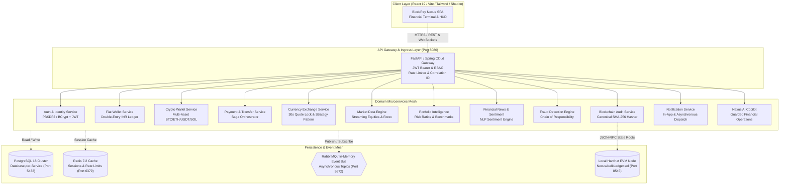
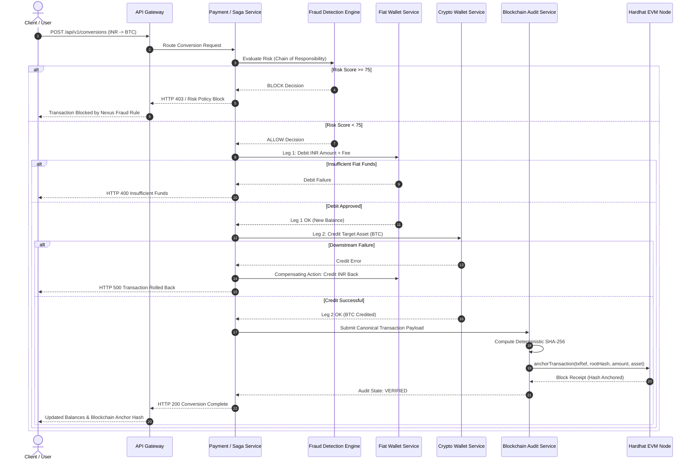
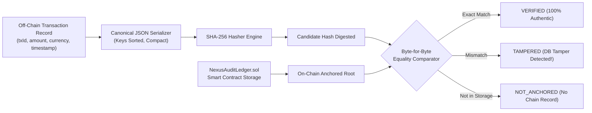
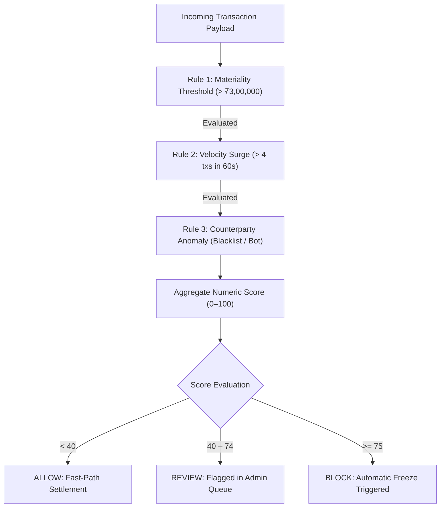

# BlockPay Nexus — Architecture Specification

## 1. High-Level System Architecture

BlockPay Nexus is an enterprise-grade, academic hybrid digital wallet and financial intelligence platform. It coordinates 13 distributed microservices behind a unified API Gateway, supporting dual-ledger fiat (INR) and crypto (BTC, ETH, USDT, SOL) custody, distributed Sagas, real-time market data, portfolio intelligence, NLP news sentiment, rule-based fraud triage, and EVM-anchored cryptographic audit logs.

---

## 2. Distributed Transaction Saga Pattern (UC-04 & UC-05)

Financial operations spanning multiple microservices (e.g. converting INR to BTC or sending funds) utilize an orchestrated Saga pattern with automated compensating actions on partial failures.

---

## 3. Blockchain Tamper-Evident Audit Mechanism

---

## 4. Chain of Responsibility Fraud Detection Architecture

